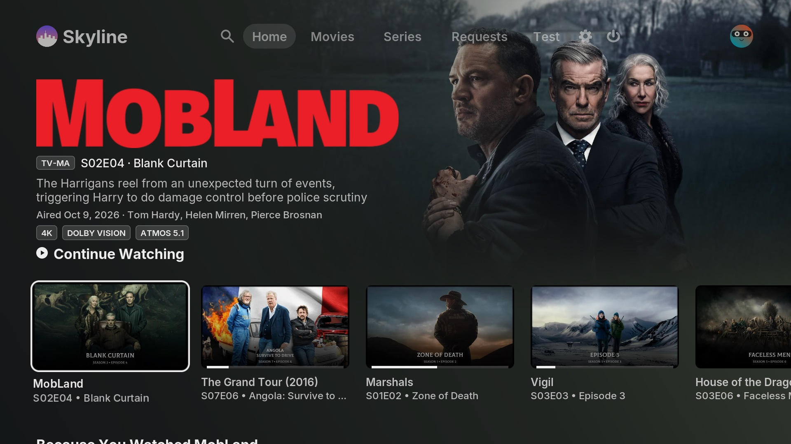
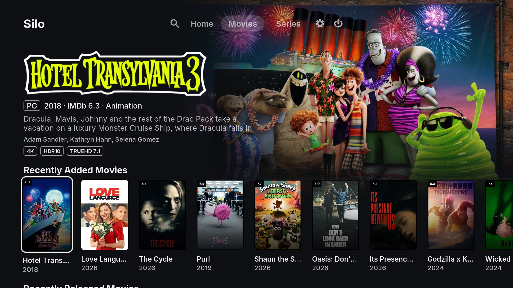
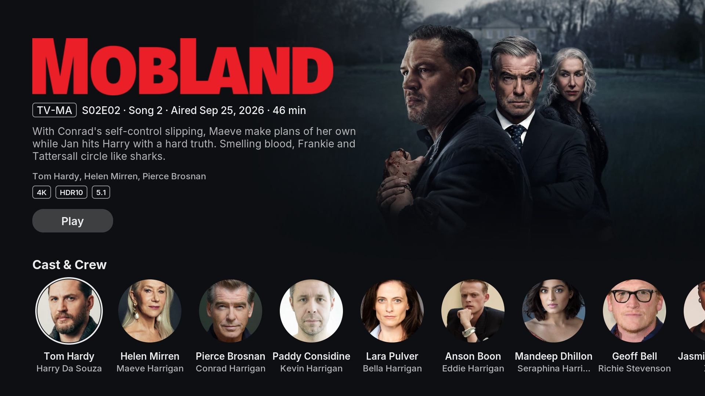

# Skyline

Skyline is a Kodi skin laid out like the [Silo](https://github.com/Silo-Server/silo-server) TV apps' Skyline home, for
Kodi 21 (Omega). It works with [SiloKodiConnect](https://github.com/im85288/SiloKodiConnect), which puts a
Silo server's movies and TV shows into Kodi's library: the skin builds its pages from the rows on your Silo
home screen, so they follow whatever Silo shows.

Community project: not made or endorsed by the Silo team.



## What it does

- **Silo's home layout.** The focused title's artwork sits crisp in the top right, drifting slowly, and fades
  into the page; its clear logo, facts (age rating, year or episode, genre, IMDb, TMDB and Rotten Tomatoes ratings), plot,
  cast and quality badges (4K, Dolby Vision or HDR10, audio) fill the top left; rows of titles run underneath.
- **Pages from Silo.** Home, Movies and Series with the rows Silo shows for each, in Silo's order:
  SiloKodiConnect publishes Home's first rows as ready-made cards, so they draw at once, and the rest load as
  you reach them. Rows far from the one you're on drop their artwork to save memory.
- **Netflix touches.** Continue Watching cards in Silo's three lines with the time left; Remove from Continue
  Watching on the context menu key (a long OK); watched titles dimmed; a NEW EPISODE tab on shows you've
  started with an episode out this week; Top 10 rows numbered on their posters; and a "TOP 10 · #3 in IMDb
  Popular Shows" line over the hero for a title in a chart's top ten.
- **Browse.** Films and series in Grid, Hero or List view, with Sort, an Unwatched filter, A-Z, genre chips and
  collections, all in Silo's own windows.
- **Detail, person and Requests pages** as Silo's Apple TV app: Play / Resume, trailers, watchlist, season
  pills and episode rails, More Like This, cast to their person pages, and Silo's Requests (Discover and Yours).
  A Rate button gives a title one to five stars, and a show's theme tune plays while its page is open.
- **Coming Soon** on Series: each show you've started with its next episode's date, from Silo's calendar.
- **Showcase player** (the default): a richer overlay, a Netflix-style pause screen after 10 seconds, and Up
  Next to match. Silo's own player style is the other choice.
- **Live TV** laid out as TiviMate, in Silo's look: guide, quick guide (its channel groups on Left), OK screen, catch-up and recent channels.
- Silo-style menus, dialogs, keyboard, notifications and settings; **Inter** throughout, as the Silo apps use.

| Movies | Series | Film |
|---|---|---|
|  |  |  |

## Your own menu items

With [Skin Shortcuts](https://github.com/mikesilvo164/script.skinshortcuts) installed, **Settings -> Customise
menu** adds items of your own beside the avatar: any add-on, library node, playlist or other shortcut, renamed
and in your order. Give an item up to four widgets and it opens them as rows on its own page, like Home's;
an item without widgets runs its action. The Silo tabs stay as they are.

## Colours

**Settings -> Interface -> Skin -> Colours** (or Skyline's skin settings) offers three colour themes:

- **Silo** (the default): Silo's near-black pages and white focus.
- **Zephyr**: a flatter dark grey with a blue focus, as Arctic Zephyr.
- **OLED**: true black pages and near-black panels.

**Artwork background** in the skin settings shows the selected title's fanart, dimmed, behind every
screen, as Arctic Zephyr does.

## Skin settings

- **General:** Colours; Recommended add-ons (Up Next, YouTube and more, with what each adds); **Top 10
  rows**, which opens SiloKodiConnect's choice of Home rows to number; Artwork background; Use slide animations;
  Theme music on show pages (on by default).
- **Player:** Player style (Showcase or Silo's) and the overlay's auto-close.

## Install

Install and sign in to SiloKodiConnect 0.10.0 or newer first, then build a zip and use Kodi's
**Add-ons -> Install from zip file**:

```bash
git archive --format=zip --prefix=skin.silo.skyline/ -o skin.silo.skyline.zip HEAD
```

Switch to it under **Settings -> Interface -> Skin**. Without SiloKodiConnect, Home asks you to install it.

## Development

The Silo screens are generated: edit the scripts in `tools/`, not the XML they write. One command rebuilds
everything in the order that works and checks that every `xml/*.xml` parses:

```bash
python3 tools/build_all.py
```

- `build_home.py`: Home (`xml/Home.xml`), the shared card includes (`xml/Includes_SiloCards.xml`), Inter in
  `xml/Font.xml`, and Home's blocks in `xml/Variables.xml` and `xml/Timers.xml`.
- `build_frame.py`: the frame every other screen shares: menus, dialogs, settings, the top bar.
- `build_info.py`: the detail page (`xml/DialogVideoInfo.xml`).
- `build_library.py`: Browse (`xml/Custom_1191_SiloLibrary.xml`, and its copy 1193 for a collection's or a
  genre's titles).
- `build_browse.py`: Kodi's own library window (`xml/MyVideoNav.xml`), for add-ons' lists.
- `build_search.py`, `build_person.py`, `build_requests.py`: search, person and request browse pages.
- `build_showcase.py`, `build_options.py`, `build_upnext.py`: the player's styles, its Options sheet and Up
  Next's windows.
- `build_tv.py`: Live TV's guide and programme information.
- `build_shortcuts.py`: the menu editor for your own menu items. Skin Shortcuts writes
  `xml/script-skinshortcuts-includes.xml` on the device, over the placeholder here.
- `build_colours.py` runs last: it turns the colours a theme changes into the names `colors/defaults.xml`,
  `Zephyr.xml` and `OLED.xml` define.
- `make_textures.py` draws the masks, focus rings, pills and badges in `media/silo/`.

Kodi reads a `$VAR` in a list's content path only once, when the window opens, so content paths stay `$INFO`;
and it keeps a list item's layout once picked, so marks follow item properties, not layouts. Check changes
with a cold Kodi start, not only `ReloadSkin()`. On a 2 GB SHIELD, measure Kodi's native heap on Home before
adding rows or pictures (`adb shell dumpsys meminfo org.xbmc.kodi`): it is about 225 MB now.

Skyline began as Estuary from Kodi 21; the few screens not yet redrawn are still Estuary's.

## Licence

Code GPL-2.0-only, as Estuary. Estuary's artwork CC-BY-SA-4.0. Inter (`fonts/`) SIL Open Font Licence 1.1,
see `fonts/inter_license.txt`.
