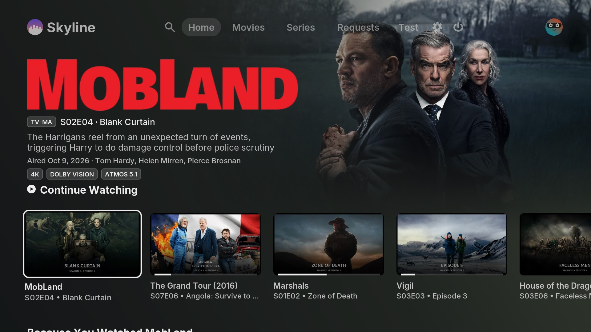
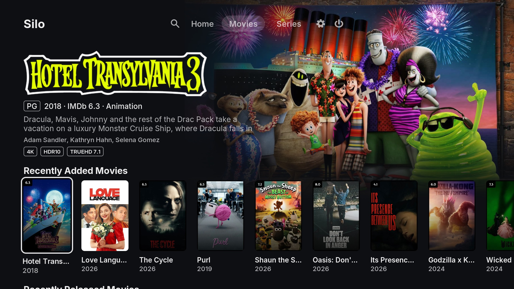

# Skyline

Skyline is a Kodi skin laid out like the [Silo](https://github.com/Silo-Server/silo-server) TV apps' Skyline home, for
Kodi 21 (Omega). It works with [SiloKodiConnect](https://github.com/im85288/SiloKodiConnect), which puts a
Silo server's movies and TV shows into Kodi's library: the skin builds its pages from the rows on your Silo
home screen, so they follow whatever Silo shows.

Community project: not made or endorsed by the Silo team.



## What it does

- **Silo's home layout.** The focused title's artwork sits crisp in the top right and fades into the page;
  its clear logo, facts line (age rating, episode, air date or year, genre, IMDb rating), plot, cast and
  quality badges (4K, Dolby Vision or HDR10, audio) fill the top left; rows of titles run underneath.
- **Pages from Silo.** Home, Movies and Series, each with the rows Silo shows for that page (Continue
  Watching, Because You Watched…, Recently Added, genre rows). SiloKodiConnect publishes them as window
  properties when it starts and after every sync; rows reload when the library changes.
- **Silo-style detail page.** Logo, facts, a three-line synopsis, credit line, badges, a Play / Resume /
  Browse pill, Trailer and Versions buttons when a title has them, and the cast as round photos.
- **Inter** throughout, as the Silo apps use.

| Movies | Episode | Film |
|---|---|---|
|  |  |  |

## Your own menu items

With [Skin Shortcuts](https://github.com/mikesilvo164/script.skinshortcuts) installed, **Settings -> Customise
menu** adds items of your own beside the avatar: any add-on, library node, playlist or other shortcut, renamed
and in your order. Give an item up to four widgets and it opens them as rows on its own page, like Home's;
an item without widgets runs its action. The Silo tabs stay as they are.

## Install

Install and sign in to SiloKodiConnect 0.9.3 or newer first, then build a zip and use Kodi's
**Add-ons -> Install from zip file**:

```bash
git archive --format=zip --prefix=skin.silo.skyline/ -o skin.silo.skyline.zip HEAD
```

Switch to it under **Settings -> Interface -> Skin**. Without SiloKodiConnect, Home asks you to install it.

## Development

The Silo screens are generated: edit the scripts in `tools/`, not the XML they write.

- `tools/build_home.py` writes `xml/Home.xml`, its block in `xml/Variables.xml`, the Inter fonts in
  `xml/Font.xml` and the start-up focus timer in `xml/Timers.xml`.
- `tools/build_info.py` writes `xml/DialogVideoInfo.xml` and its variables.
- `tools/build_browse.py` writes `xml/MyVideoNav.xml` (library browsing) and its variables.
- `tools/build_search.py` writes `xml/Custom_1190_SiloSearch.xml` (search) and its variables.
- `tools/build_upnext.py` writes Up Next's windows (`xml/script-upnext-*.xml`: Next Up, Still watching,
  Skip intro) in Silo's player style, and their variables.
- `xml/script-skinshortcuts.xml` (the menu manager) and `shortcuts/` are hand-written; Skin Shortcuts
  writes `xml/script-skinshortcuts-includes.xml` on the device, over the placeholder here.
- `tools/make_textures.py` draws the masks, focus rings, pills and badges in `media/silo/`.

Run `build_home.py` first, then the others, since they all write blocks into `xml/Variables.xml`. Kodi reads a
`$VAR` in a list's content path only once, when the window opens, so content paths stay `$INFO`; check
changes with a cold Kodi start, not only `ReloadSkin()`.

Everything else is Estuary as shipped with Kodi 21, which the Silo screens replace page by page.

## Licence

Code GPL-2.0-only, as Estuary. Estuary's artwork CC-BY-SA-4.0. Inter (`fonts/`) SIL Open Font Licence 1.1,
see `fonts/inter_license.txt`.
